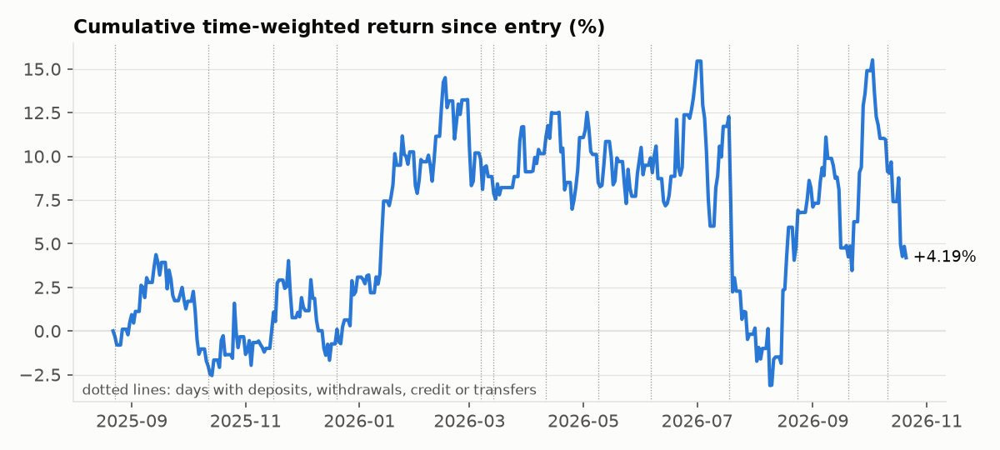
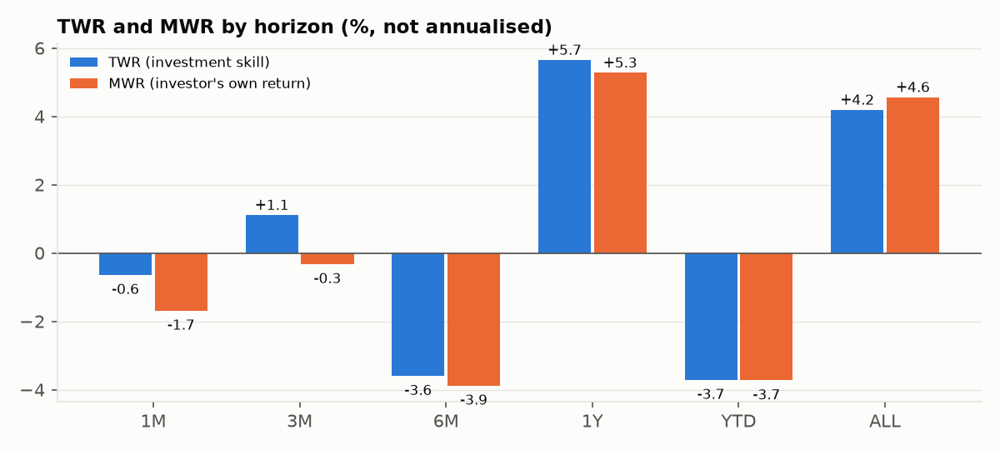
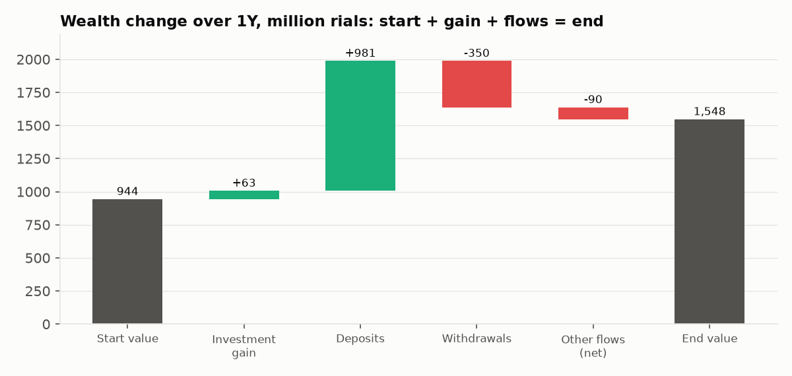

# Portfolio Return Engine


Time-weighted return (TWR), money-weighted return (MWR, via a robust XIRR) and wealth change
for a brokerage account, from a transaction ledger and end-of-day values. It separates
external cash flows from trades and corporate actions, handles purchase credit and options,
uses ISO 8601 dates and Gregorian calendar periods, and decides which numbers are safe to show.

**Portfolio context.** This personal reference implementation demonstrates financial
Product Owner work: explicit methodology, edge cases, data contracts, acceptance criteria
and reproducible synthetic examples. It is an educational reconstruction, not employer
source code or a statement of deployed behaviour. Financial policies and thresholds in this
repository are local demonstration choices. No production scale, release outcome or
organizational approval is claimed.

**Portfolio analytics chain.** Inputs can be checked by
[Portfolio Data Quality](https://github.com/Amir-Shokat/portfolio-data-quality). This engine's TWR output feeds
[Portfolio Risk Metrics](https://github.com/Amir-Shokat/portfolio-risk-metrics), while
[Return Monitoring](https://github.com/Amir-Shokat/return-monitoring) supervises daily production outcomes.

## What's inside

| Module | Contents |
|---|---|
| `transactions` | rule table for 28 transaction types: external flow sign, category and effect on cash, holdings and credit; unmapped types block instead of being guessed; full audit table |
| `valuation` | daily table: levels carried over weekends and holidays, flows never; unknown and conflicting values flagged; gross daily inflows and outflows |
| `credit` | purchase credit as capital (added once, grant = inflow, removal = outflow), negative-cash policy, credit inconsistency checks |
| `twr` | daily TWR with inflow at the start and outflow at the end of the day, daily statuses (low capital, no capital, invalid), geometric linking, cumulative chart rebased to 0%, subperiod view |
| `xirr` | XIRR on Actual/365 solved on `log(1 + r)` with bracket scan, all roots reported, explicit failure statuses; spreadsheet-style Newton for comparison |
| `mwr` | horizon MWR with boundary rules (tiny start value, total loss, no investment), periodic and annual rate |
| `wealth_change` | `EV - BV - net flow`, the four-number identity, waterfall that keeps credit apart from deposits |
| `horizons`, `dates` | 1M/3M/6M/1Y (3Y/5Y), YTD, since entry and Gregorian calendar years; month-end clipping and short-history policies |
| `display_policy` | shown / warning / hidden / status text per horizon, illustrative bands, band calibration from an output distribution, TWR-versus-MWR explanation text |
| `quality`, `engine`, `cli` | data-quality checks (late deposits, large unexplained moves), control counters, end-to-end run, `portfolio-returns` command |

## Quick start

```bash
git clone https://github.com/Amir-Shokat/portfolio-return-engine.git
cd portfolio-return-engine
pip install -e ".[dev]"            # add ",charts" to redraw docs/*.png
pytest                             # 105 tests

portfolio-returns --transactions examples/transactions.csv \
    --values examples/daily_values.csv --as-of 2026-10-21 --years --audit audit.csv
```

```python
import pandas as pd
from portfolio_returns import analyse, daily_return, xirr

daily_return(1_000e6, 1_050e6, inflow=500e6, outflow=500e6)   # (0.0333, 'CALCULATED', None)
xirr(["2025-01-01", "2026-01-01", "2027-01-01"], [-100, 230, -132]).roots   # (0.10, 0.20)

rep = analyse(pd.read_csv("examples/transactions.csv"), pd.read_csv("examples/daily_values.csv"),
              as_of="2026-10-21")
rep.horizons[["horizon", "twr", "mwr", "wc", "twr_display"]]
```

## Example output

One synthetic account (`U001`) covers deposits and withdrawals, a same-day deposit and
withdrawal, transferred shares, a cash dividend paid externally, bonus shares, a rights issue,
purchase credit, an option settled by delivery and a deposit posted one day late. A typical CLI
report looks like this:

```
As of 2026-10-21; amounts in currency units; returns not annualised
Transactions: 14 external, 19 internal, 0 snapshots, 0 unmapped, 0 invalid, 0 duplicates ignored

Horizon From       To         Basis               TWR        MWR    Wealth change  Notes
----------------------------------------------------------------------------------------
1M      2026-09-21 2026-10-21 full_period      -0.64%     -1.68%      -23,655,218
3M      2026-07-21 2026-10-21 full_period      +1.11%     -0.32%       -4,106,102  TWR and MWR differ in sign: timing
6M      2026-04-21 2026-10-21 full_period      -3.59%     -3.88%      -51,937,571
1Y      2025-10-21 2026-10-21 full_period      +5.65%     +5.28%       62,989,043
YTD     2026-01-01 2026-10-21 full_period      -3.71%     -3.73%      -49,425,043
ALL     2025-08-23 2026-10-21 since_entry      +4.19%     +4.56%       52,475,020

Year          TWR        MWR    Wealth change
2025       +8.21%     +9.50%      101,900,063
2026       -3.71%     -3.73%      -49,425,043 (to date)
calendar years link to ALL: True
```

The same account with one transaction type the rule table does not know (dated 2026-09-01).
Every horizon whose window contains it is hidden; 1M, which starts later, is unaffected:

```
1M      2026-09-21 2026-10-21 full_period      -0.64%     -1.68%      -23,655,218
3M      2026-07-21 2026-10-21 full_period      hidden     hidden           hidden  return unavailable
...
ALL     2025-08-23 2026-10-21 since_entry      hidden     hidden           hidden  return unavailable
```

<p> </p>
<p></p>

## Edge cases handled

| Case | What went wrong | Rule |
|---|---|---|
| Deposit and withdrawal of the same size on one day | Netted to zero; return measured on the wrong capital (5.00% instead of 3.33% in the test case) | Gross flows; inflow at the start of the day, outflow at the end |
| A few thousand currency units left after a full withdrawal | +300% days compounding into absurd yearly returns | Days with capital below a minimum are flat, counted and reported |
| Tiny start value, then a deposit late in the year | "1Y" MWR of +215% for a +10% month | Start value below the minimum treated as zero for MWR |
| Short window with a big move; flows changing sign twice | Spreadsheet XIRR fails or silently picks one of two roots | Solve on `log(1 + r)`, scan for all roots, explicit statuses |
| Cash dividend paid to the bank account | Ex-dividend price drop looked like a loss | Outflow (distribution) |
| Shares moved in from another broker | Looked like profit | Inflow at market value |
| Buying with purchase credit | +33% on a day with no price change when credit was counted twice | Credit added once, as capital; raw negative cash kept |
| New transaction type in the feed | Silently treated as zero | Unmapped: blocks only the horizons containing it |
| Missing or conflicting daily value | Carried forward as if known | Unknown; the horizon is hidden and the chart line stops |
| One month before 31 March; YTD boundary | Fixed 30 days; wrong year boundary | Calendar months with clipping; YTD from 1 January |
| Cumulative chart not matching the horizon number | Chart and card used different start days | Chart rebased to 0% on the horizon's anchor |
| Value not calculable | Shown as 0% | Status text ("Insufficient history"), never 0% |

The full catalogue is in [docs/edge-cases.md](docs/edge-cases.md).

## Documentation

- [Methodology](docs/methodology.md): TWR, MWR, wealth change, horizons, formulas and statuses
- [Transaction mapping](docs/transaction-mapping.md): the external-flow rule table and why each borderline case is classified as it is
- [Display policy](docs/display-policy.md): shown, warning, hidden; band calibration; comparison text
- [Credit and options](docs/credit-and-options.md): the credit and options assumptions used by this demonstration
- [Edge cases](docs/edge-cases.md), [Decision log](docs/decisions.md), [Business requirements](docs/business-requirements.md), [Validation](docs/validation.md)
- BDD scenarios: [docs/features/](docs/features/)

## License

MIT
